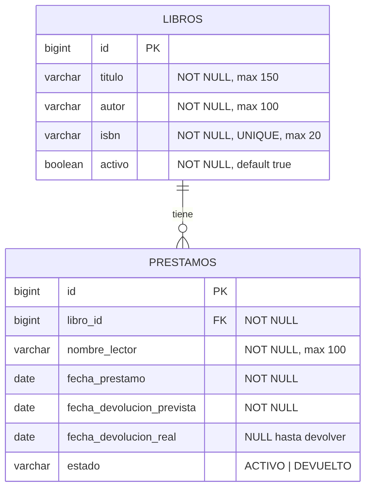

# Proyecto Final: Préstamos de una Biblioteca Comunitaria (PF-01)

| | |
|---|---|
| **Estudiante** | Jaime Alejandro Monzón Contreras |
| **Carné** | 9941-24-11049 |
| **Curso** | Programación II — Universidad Mariano Gálvez de Guatemala (UMG) |
| **Proyecto asignado** | PF-01 — Préstamos de una biblioteca comunitaria |

---

## Descripción del problema

Una biblioteca comunitaria pequeña administra sus libros y los préstamos que hace a sus lectores de forma manual, por lo que no sabe con certeza qué libros están disponibles, quién tiene cada libro ni qué préstamos están vencidos.

El sistema permite registrar libros y préstamos, impedir que un libro tenga dos préstamos activos a la vez, registrar devoluciones, consultar libros disponibles, préstamos activos y vencidos, y ver un resumen (indicadores) del estado de la biblioteca.

## Tecnologías utilizadas

- Java 21
- Spring Boot 4.1.1 (Spring Web MVC, Spring Data JPA, Validation)
- Maven
- PostgreSQL + Hibernate/JPA
- HTML5, CSS3 y JavaScript (Fetch API)
- Postman (pruebas de la API) y JUnit 5 + Mockito (pruebas unitarias de los servicios)

## Estructura general del sistema

```text
src/main/java/com/biblioteca/prestamos/
├── controller/   # Endpoints REST (LibroController, PrestamoController)
├── service/      # Lógica y reglas de negocio (LibroService, PrestamoService)
├── repository/   # Acceso a datos con Spring Data JPA
├── entity/       # Entidades JPA: Libro, Prestamo, EstadoPrestamo
├── dto/          # Objetos de entrada/salida de la API (con validaciones)
├── exception/    # Excepciones propias y GlobalExceptionHandler (@RestControllerAdvice)
└── config/       # Configuración CORS
src/main/resources/
├── application.properties
├── application-local.properties.example
└── static/       # Frontend: index.html, css/styles.css, js/app.js
database/         # 01_crear_estructura.sql y 02_datos_prueba.sql
postman/          # Colección de Postman
docs/             # Diagrama de entidades
evidencias/       # Documento de seguimiento y evidencias (Word)
```

Flujo de una petición: `Controller` (recibe y valida el DTO) → `Service` (reglas de negocio) → `Repository` (JPA/PostgreSQL). Los errores se lanzan como excepciones propias y los convierte en respuestas HTTP el `GlobalExceptionHandler`.

### Diagrama de entidades



Un **libro** puede tener muchos **préstamos** a lo largo del tiempo (relación 1 : N, `prestamos.libro_id → libros.id`).

## Requisitos para ejecutar el proyecto

- JDK 21
- Maven (o el wrapper incluido `mvnw`)
- PostgreSQL 14 o superior

## Configuración de PostgreSQL

1. Crear la base de datos (conectado a la base `postgres`):
   ```sql
   CREATE DATABASE biblioteca_db;
   ```
2. Conectarse a `biblioteca_db` y ejecutar, en este orden:
   - `database/01_crear_estructura.sql` (tablas, llaves, restricciones)
   - `database/02_datos_prueba.sql` (12 libros y 8 préstamos de prueba)
3. Configurar la conexión **sin publicar la contraseña**. Copiar el archivo de ejemplo:
   ```text
   src/main/resources/application-local.properties.example
        →  src/main/resources/application-local.properties
   ```
   y escribir en el nuevo archivo el usuario y la contraseña propios. `application-local.properties` está en el `.gitignore` y no se sube a GitHub.

   Alternativa: definir las variables de entorno `DB_URL`, `DB_USER` y `DB_PASSWORD`.

> Si se omite el paso 2, Hibernate crea las tablas automáticamente (`ddl-auto=update`), pero sin los datos de prueba ni la restricción que impide dos préstamos activos del mismo libro a nivel de base de datos.

## Iniciar el backend

```bash
./mvnw spring-boot:run        # Linux / macOS
mvnw.cmd spring-boot:run      # Windows
```

El servidor inicia en `http://localhost:8081`. Para ejecutar las pruebas unitarias: `./mvnw test`.

## Abrir el frontend

Con el backend iniciado, abrir en el navegador: **http://localhost:8081/**

(El frontend está en `src/main/resources/static`, por lo que Spring Boot lo sirve directamente.)

## Endpoints

### Libros — `/api/libros`

| Método | Ruta | Descripción | Respuestas |
|---|---|---|---|
| POST | `/api/libros` | Registrar libro | 201, 400, 409 (ISBN duplicado) |
| GET | `/api/libros` | Listar todos los libros | 200 |
| GET | `/api/libros/{id}` | Consultar por identificador | 200, 404 |
| PUT | `/api/libros/{id}` | Modificar libro | 200, 400, 404, 409 |
| DELETE | `/api/libros/{id}` | Desactivar libro (eliminación lógica) | 200, 404, 422 |
| PUT | `/api/libros/{id}/activar` | Reactivar libro | 200, 404, 422 |
| GET | `/api/libros/disponibles` | **Filtro 1:** libros activos sin préstamo activo | 200 |
| GET | `/api/libros/buscar?texto=` | **Filtro 2:** búsqueda por título o autor | 200, 400 |

### Préstamos — `/api/prestamos`

| Método | Ruta | Descripción | Respuestas |
|---|---|---|---|
| POST | `/api/prestamos` | **Operación de negocio:** registrar préstamo | 201, 400, 404, 422 |
| GET | `/api/prestamos` | Listar préstamos | 200 |
| GET | `/api/prestamos/{id}` | Consultar por identificador | 200, 404 |
| PUT | `/api/prestamos/{id}` | Modificar lector o plazo de un préstamo activo | 200, 400, 404, 422 |
| PUT | `/api/prestamos/devolver/{id}` | Registrar devolución (estado → DEVUELTO) | 200, 404, 422 |
| GET | `/api/prestamos/activos` | **Filtro:** préstamos activos | 200 |
| GET | `/api/prestamos/vencidos` | **Filtro:** préstamos vencidos | 200 |
| GET | `/api/prestamos/buscar?lector=` | **Filtro:** préstamos por lector | 200, 400 |
| GET | `/api/prestamos/indicadores` | **Indicador:** resumen de libros y préstamos | 200 |

Ejemplo de solicitud para registrar un préstamo:

```json
POST /api/prestamos
{ "libroId": 5, "nombreLector": "Ana López", "diasPlazo": 7 }
```

Ejemplo de respuesta de error (formato único para toda la API):

```json
{
  "timestamp": "2026-11-07T17:30:00",
  "status": 422,
  "error": "Unprocessable Entity",
  "message": "El libro 'El Principito' ya tiene un préstamo activo.",
  "errors": {},
  "path": "/api/prestamos"
}
```

En los errores de validación (400), `errors` contiene el mensaje de cada campo inválido.

### Indicador (`/api/prestamos/indicadores`)

Devuelve: total de libros, libros activos, libros disponibles, libros prestados, **porcentaje de libros prestados**, total de préstamos, préstamos activos, devueltos y vencidos.

## Reglas principales del negocio

1. Un libro solo puede prestarse si **existe** y está **activo**.
2. Un libro **no puede tener dos préstamos activos** al mismo tiempo (validado en el servicio y, además, con un índice único parcial en PostgreSQL).
3. El plazo del préstamo debe ser de **1 a 30 días**; la fecha prevista de devolución se calcula a partir de la fecha del préstamo.
4. Un préstamo **ya devuelto no puede devolverse ni modificarse** de nuevo.
5. Un préstamo es **vencido** cuando sigue activo y su fecha prevista de devolución ya pasó.
6. Un libro **no puede desactivarse** si tiene un préstamo activo. Los libros no se eliminan físicamente para conservar el historial.
7. El **ISBN es único**; no se permiten libros con el mismo ISBN.

## Códigos HTTP utilizados

| Código | Cuándo |
|---|---|
| 200 / 201 | Operación exitosa / recurso creado |
| 400 | Datos inválidos, JSON mal formado, parámetro faltante o con formato incorrecto |
| 404 | Libro, préstamo o ruta inexistente (incluye relación inexistente al prestar) |
| 405 | Método HTTP no permitido |
| 409 | Registro duplicado (ISBN) |
| 422 | Incumplimiento de una regla de negocio |
| 500 | Error inesperado del sistema |

## Pruebas

- **Postman:** importar `postman/PF-01_Biblioteca.postman_collection.json` y ejecutar la colección completa (*Run collection*) con la base de datos cargada con los scripts de `database/`.
- **Unitarias:** `PrestamoServiceTest` y `LibroServiceTest` verifican las reglas de negocio con Mockito, sin necesidad de base de datos.
- **Evidencias:** documento de seguimiento en `evidencias/`.
